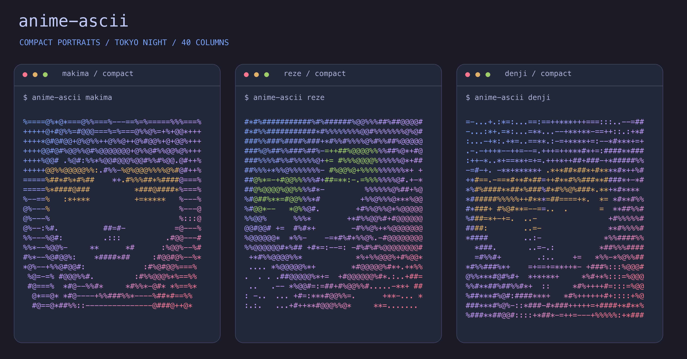
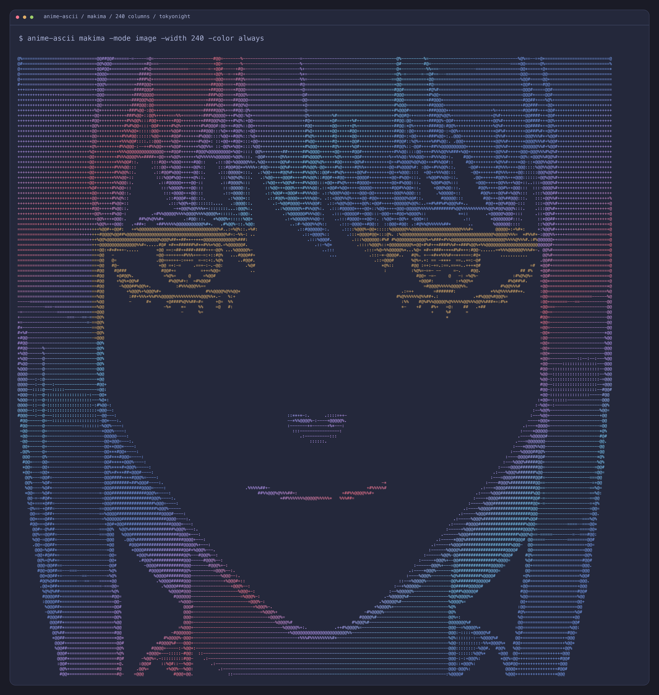
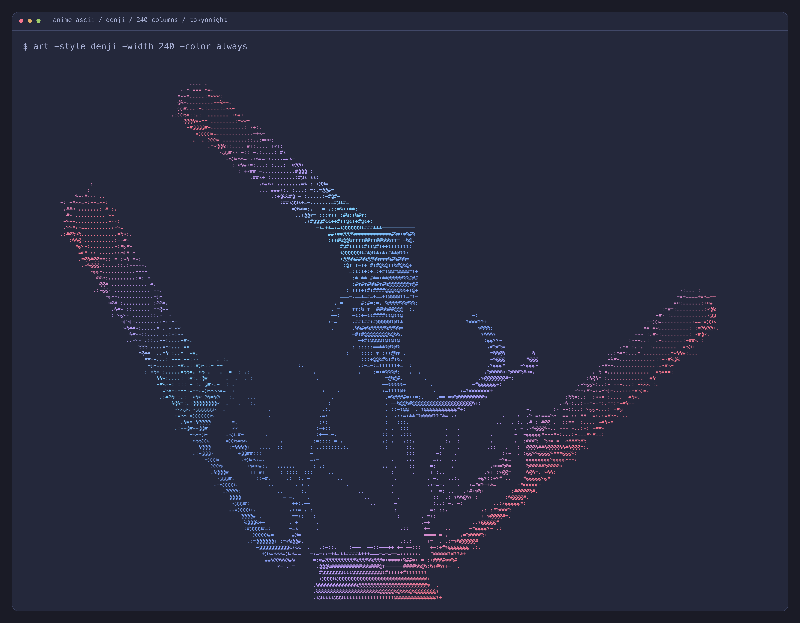

# anime-ascii

Makima, Reze and Denji illustrations converted into ASCII for your Unix terminal, in the Tokyo Night palette. A Go HTTP server supplies the converted portraits; the CLI adds ANSI truecolor.



The portraits were converted from illustrations by [eastman](https://wall.alphacoders.com/big.php?i=1284789), [SpringHaru](https://twiman.net/user/1348570965135949830/illust/1970415339994521708), and an [official Denji character visual](https://natalie.mu/eiga/gallery/news/616805/2555644). The previews render actual captured CLI output at 3× resolution. The gallery uses 160-column portraits; individual previews use 240 columns. For sharp zooming, open the vector versions: [portrait gallery](docs/images/anime-gallery.svg) [Makima terminal](docs/images/makima-terminal.svg), [Reze terminal](docs/images/reze-terminal.svg), and [Denji terminal](docs/images/denji-terminal.svg).

## Quick start

You need **Go 1.26+**. The project uses only the Go standard library.

```sh
git clone https://github.com/Godsdar/anime-ascii.git
cd anime-ascii
go run ./cmd/server
```

Keep the server running. In a second terminal, from the same directory:

```sh
go run ./cmd/art -style makima
```

Use a terminal that supports ANSI escape sequences and 24-bit color. The default is 160 columns. Use `-width 80` for a compact view or `-width 240` for the most detail. Larger portraits need a wide terminal and may extend below the screen; pipe plain output into `less` to scroll.



## Choose a character

| Character | Style | Details |
| --- | --- | --- |
| Makima | `makima` | Converted portrait by eastman. Default. |
| Reze | `reze` | Converted illustration by SpringHaru. |
| Denji | `denji` | Chainsaw Man form, converted from a film character visual. |

```sh
go run ./cmd/art -style makima -color always
go run ./cmd/art -style reze -color always
go run ./cmd/art -style reze -width 240 | less
go run ./cmd/art -style denji -width 240 -color always
```

The facial expressions come from the source images. The portraits are static. Optional `-animate` moves the color gradient; it requires a terminal tall enough to hold the entire portrait. Ctrl+C returns to your shell.

## Resolution

Choose `-width 80`, `100`, `160`, `200`, or `240`. Each version is converted directly from the source image. The height grows with the width to preserve the portrait proportions.

| Character | Default (160 columns) | Detailed (240 columns) |
| --- | --- | --- |
| Makima | 160 × 108 | 240 × 162 |
| Reze | 160 × 112 | 240 × 168 |
| Denji | 160 × 57 | 240 × 85 |

```sh
go run ./cmd/art -style makima -width 240 -color always
go run ./cmd/art -style denji -width 240 -color always | less -R
```



[Open the vector Denji preview](docs/images/denji-terminal.svg).

## Colors and pipes

The default theme is `tokyonight`: blue (`#7aa2f7`), purple (`#bb9af7`), cyan (`#7dcfff`), and pink (`#f7768e`). The previews use Tokyo Night background colors as well. The CLI colors the text and keeps your terminal background. `-theme rainbow` and `-theme pastel` remain available.

| Option | Behavior |
| --- | --- |
| `-color auto` | Enables color for a character-device stdout unless `NO_COLOR` is set or `TERM=dumb`. Default. |
| `-color always` | Forces ANSI truecolor output. |
| `-color never` | Prints plain text. |

Redirecting ordinary output to a file or pipe leaves out the color codes:

```sh
go run ./cmd/art -style makima > makima.txt
go run ./cmd/art -style reze | less
```

Use `-animate` in an interactive terminal. It uses screen-control sequences even when colors are disabled.

## Turn your own image into ASCII

The converter accepts PNG, JPEG, and GIF. It maps image brightness to characters and can apply the same color themes to the result. `-invert` makes dark pixels produce dense characters, which works well for illustrations on a white background. `-contrast` accepts values from 0.1 to 3 (default 1).

```sh
go run ./cmd/art -image picture.png -width 100 -invert -contrast 1.5 -color always
go run ./cmd/art -image picture.png -width 100 > picture.txt
```

Uploads are limited to **8 MiB** and **12 million pixels**. Output width is 10 to 240 characters, with a maximum height of 180 lines. Transparent pixels blend onto black; GIF conversion uses the first frame. Very tall images are compressed when they reach the height limit.

To convert locally without a server:

```sh
go run ./cmd/convert -image picture.jpg -width 100 -invert -contrast 1.5 > picture.txt
```

Add `-crop left,top,right,bottom` to select a region in source pixels. The bundled portraits use this same Go converter; exact settings and source credits are in [artwork sources](internal/art/portraits/SOURCES.md).

## Use curl

Get a colored portrait without the CLI:

```sh
curl -fsS 'http://127.0.0.1:8080/art?style=makima&color=tokyonight'
curl -fsS 'http://127.0.0.1:8080/art?style=reze&mood=happy&color=tokyonight'
```

Convert an image by sending its bytes as the request body:

```sh
curl -fsS --data-binary @picture.png \
  'http://127.0.0.1:8080/convert?width=100' > picture.txt
```

## HTTP API

| Route | Response |
| --- | --- |
| `GET /` | Endpoint reference. |
| `GET /art` | Plain-text Makima portrait by default. |
| `GET /preview?style=makima` | A single colored frame in the browser. |
| `POST /convert?width=80` | ASCII from a raw PNG, JPEG, or GIF request body. |
| `GET /fast` | A response after 200 ms for the concurrency demo. |
| `GET /slow` | A response after one second for the concurrency demo. |

`/art` and `/preview` accept `style`, portrait `width` (80/100/160/200/240), and a nonnegative integer `frame` for the color gradient. The `color` parameter accepts `none`, `tokyonight`, `rainbow`, or `pastel`. `/art` defaults to `none`; `/preview` defaults to `tokyonight`.

Successful `/art` and `/convert` responses use `text/plain; charset=utf-8`. Invalid parameters or images return **400**; oversized uploads or image dimensions return **413**.

`/convert` also accepts `invert=true` and `contrast=1.5`.

The server listens on `127.0.0.1:8080` by default. To use another port:

```sh
go run ./cmd/server -addr 127.0.0.1:8090
go run ./cmd/art -server http://127.0.0.1:8090 -style makima
```

## Build and check

```sh
mkdir -p bin
go build -o bin/ascii-server ./cmd/server
go build -o bin/art ./cmd/art
go test -race ./...
go vet ./...
```

Run `./bin/ascii-server` in one terminal and `./bin/art -style makima` in another. The compiled binaries run without a Go installation.

The CLI is intended for macOS and Linux. It has been tested on macOS.

## Source map

| Path | Purpose |
| --- | --- |
| `cmd/server/` | HTTP server and request handlers. |
| `cmd/art/` | Terminal client, flags, and signal handling. |
| `internal/art/` | Embedded converted portraits, color gradients, and image conversion. |
| `cmd/convert/` | Local image-to-ASCII conversion with crop, inversion, and contrast controls. |
| `cmd/check/` | A separate concurrent URL-checking demo. |

The bundled portraits are image conversions embedded as plain ASCII text. Source raster files are not included. Image conversion also works with files you provide; it does not generate new illustrations.

Characters: Makima, Reze and Denji from Chainsaw Man, by Tatsuki Fujimoto.
