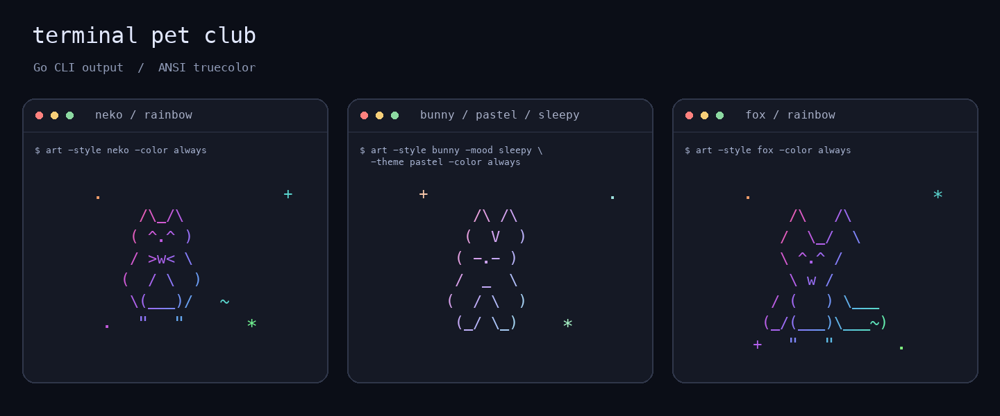
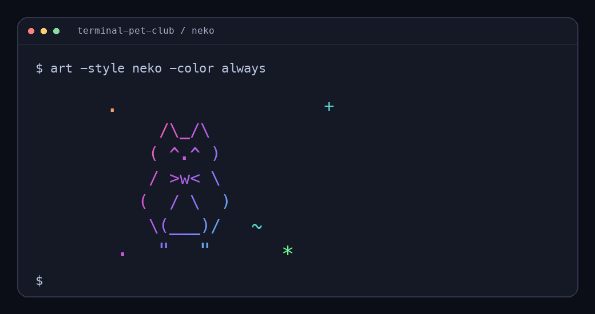

# Terminal Pet Club

Small ASCII pets for your Unix terminal, with rainbow gradients, soft pastel colors, and blinking eyes. A Go HTTP server supplies the artwork; the CLI brings it into your terminal.



The previews above and below render captured CLI output, including its ANSI truecolor values.

## Quick start

You need **Go 1.26+**. The project uses only the Go standard library.

```sh
git clone https://github.com/Godsdar/terminal-pet-club.git
cd terminal-pet-club
go run ./cmd/server
```

Keep the server running. In a second terminal, from the same directory:

```sh
go run ./cmd/art -style neko -animate
```

Press **Ctrl+C** to stop and return to your shell. Use a terminal that supports ANSI escape sequences and 24-bit color.



## Pick a pet

| Pet | Style | Try it |
| --- | --- | --- |
| Cat | `neko` | `go run ./cmd/art -style neko` |
| Bunny | `bunny` | `go run ./cmd/art -style bunny -theme pastel` |
| Fox | `fox` | `go run ./cmd/art -style fox -mood surprised` |
| Robot | `mecha` | `go run ./cmd/art -style mecha` |

Choose `happy`, `sleepy`, or `surprised` with `-mood`. The aliases `cat` and `chibi` also work for the cat and bunny.

```sh
go run ./cmd/art -style bunny -mood sleepy -theme pastel -animate
go run ./cmd/art -style fox -color always
```

## Colors and pipes

The default theme is `rainbow`. Use `-theme pastel` for softer colors.

| Option | Behavior |
| --- | --- |
| `-color auto` | Enables color for a character-device stdout unless `NO_COLOR` is set or `TERM=dumb`. Default. |
| `-color always` | Forces ANSI truecolor output. |
| `-color never` | Prints plain text. |

Redirecting ordinary output to a file or pipe leaves out the color codes:

```sh
go run ./cmd/art -style neko > neko.txt
go run ./cmd/art -style fox | less
```

Use `-animate` in an interactive terminal. It uses screen-control sequences even when colors are disabled.

## Turn your own image into ASCII

The converter accepts PNG, JPEG, and GIF. It maps image brightness to characters and can apply the same color themes to the result.

```sh
go run ./cmd/art -image picture.png -width 100 -color always
go run ./cmd/art -image picture.png -width 100 > picture.txt
```

Uploads are limited to **8 MiB** and **12 million pixels**. Output width is 10 to 160 characters, with a maximum height of 80 lines. Transparent pixels blend onto black; GIF conversion uses the first frame. Very tall images are compressed when they reach the height limit.

## Use curl

Get a colored pet without the CLI:

```sh
curl -fsS 'http://127.0.0.1:8080/art?style=fox&color=rainbow'
curl -fsS 'http://127.0.0.1:8080/art?style=bunny&mood=sleepy&color=pastel'
```

Convert an image by sending its bytes as the request body:

```sh
curl -fsS --data-binary @picture.png \
  'http://127.0.0.1:8080/convert?width=100' > picture.txt
```

## HTTP API

| Route | Response |
| --- | --- |
| `GET /` | Endpoint reference. |
| `GET /art` | Plain-text cat artwork by default. |
| `GET /preview?style=neko` | A single colored frame in the browser. |
| `POST /convert?width=80` | ASCII from a raw PNG, JPEG, or GIF request body. |
| `GET /fast` | A response after 200 ms for the concurrency demo. |
| `GET /slow` | A response after one second for the concurrency demo. |

`/art` and `/preview` accept `style`, `mood`, and a nonnegative integer `frame`. The `color` parameter accepts `none`, `rainbow`, or `pastel`. `/art` defaults to `none`; `/preview` defaults to `rainbow`.

Successful `/art` and `/convert` responses use `text/plain; charset=utf-8`. Invalid parameters or images return **400**; oversized uploads or image dimensions return **413**.

The server listens on `127.0.0.1:8080` by default. To use another port:

```sh
go run ./cmd/server -addr 127.0.0.1:8090
go run ./cmd/art -server http://127.0.0.1:8090 -style neko
```

## Build and check

```sh
mkdir -p bin
go build -o bin/ascii-server ./cmd/server
go build -o bin/art ./cmd/art
go test -race ./...
go vet ./...
```

Run `./bin/ascii-server` in one terminal and `./bin/art -style neko -animate` in another. The compiled binaries run without a Go installation.

The CLI is intended for macOS and Linux. It has been tested on macOS.

## Source map

| Path | Purpose |
| --- | --- |
| `cmd/server/` | HTTP server and request handlers. |
| `cmd/art/` | Terminal client, flags, and signal handling. |
| `internal/art/` | Pet templates, color gradients, and image conversion. |
| `cmd/check/` | A separate concurrent URL-checking demo. |

The pets are built from text templates. Image conversion works with files you provide; it does not generate new illustrations.
